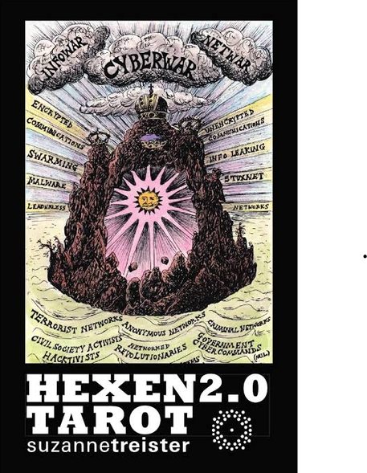
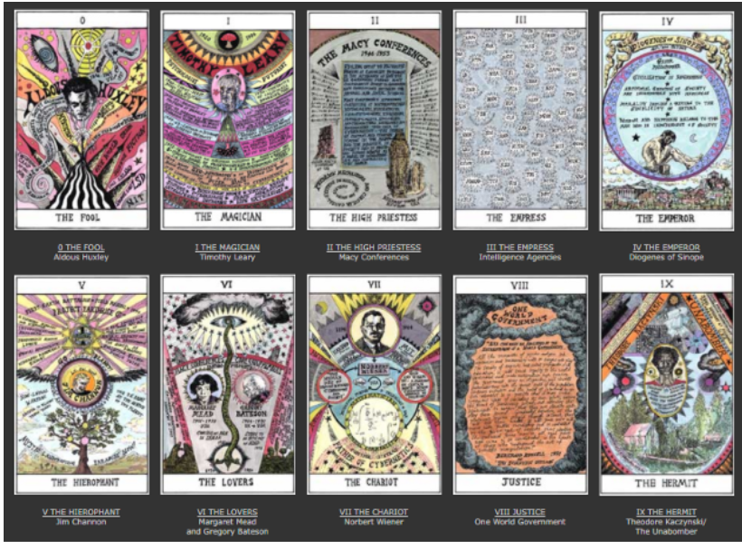
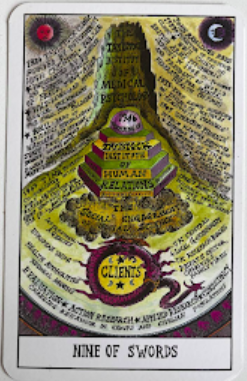
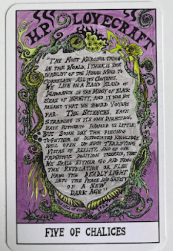
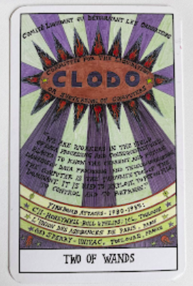

# Suzanne Tresister's Tarot 
## Course by  Joël Vacheron

Hexen 2.0 Tarot by Suzanne Treister | Pages of Hackney

Suzanne Treister's Hexen 2.0 Tarot | by Cynthia Giles | Tarot Ephemeral | Medium 

HEXEN 2.0 : 

Presents each card of the tarot as part of an entangled system to help imagine futures outside the current late capitalist paradigm.

These twenty-first century mutations are designed not so much for prophesy as to help us think our way through a techno-futurist present, and where it may lead us if we don’t learn to control it. 

----- 

The Nine of Swords

- Traditional Meaning: often associated with fear and anxiety, about all the things that worry you and keep you up at night. Sometimes this card can be associated with trauma - one which may be shameful for you to confide with others about, and all the psychological responses that come from experiencing that trauma.

- Hexen 2.0 reinterpretation: the card shift from From personal anxiety to systemic, institutionalized psychological manipulation and societal control, becoming The Tavistock institute of human relations.  

- Historical Context: formally established in September 1947, the Tavistock Institute of Human Relations is a British non-profit research and consulting organisation, specialising in the study of group behaviour. Its foundations lie in the group dynamics and psychiatric testing developed within the British Army during World War II

----

The Five of Cups: 

- Traditional Meaning: represents grief, deep disappointment, and focusing on emotional loss rather than remaining opportunities. This is a card which signifies loss as well as the painful challenges which stem from that particular loss.

- Hexen 2.0 reinterpretation: Linked to Lovecraft’s short story, "The Call of Cthulhu" - 1926 It states that the most merciful thing in the world is the human mind's inability to correlate all its contents. Lovecraft warns that humanity will either go mad from the revelation or flee into the safety of a new dark age. 

- Modern Parallel: It refers to the interconnected histories of cybernetics, information technology, social engineering, counterculture, and systems of societal control. It suggests a dark warning : the total information transparency under the web might create collective psychological dread rather than true enlightenment.

---- 

The Two of wands:  

- Traditional meaning: represents fear of the unknown, hesitation, indecision, or over-planning without taking action.  You might feel stuck in your comfort zone or afraid that your plans will fall apart. It encourages you to address your fears and stop delaying your next steps 

- Hexen 2.0 Reinterpretation:  Linked to CLODO(Comité Liquidant ou Détournant les Ordinateurs) anti-computer anarchist group active in the early 1980s. Data-processing workers based in Toulouse and Paris, France. Between 1980 and 1983,  a period marked by a severe wave of terrorism in France. They viwedcomputers as dangerous tools designed by the dominant class to control, repress and exploit workers. 

- The message: Instead of looking forward to progress, the card highlights a radical attempt to halt a technologically dominated future. It acts as a historical warning about the early resistance to the digital control systems that shape the modern internet era.

 ------------------------------------------------------------------------ 

 

 

 

