## The Artefacts of Intelligence and the ecosystem of meaning 
living system 

## AI systems : 

now in differents medium : video movie image text music -> Generative AI 
Europe is scaling back its landmark privacy and AI laws, folds under the big tech's pressure

Knight of sword in Suzanne Treister, Hexen 2.0 : the commodification of the earth : Extractivism 

Knight of sword 1909 rider waite smith tarot deck by Pamela Colman Smith

The apocalypse the four horsemen albrecht durer 1511
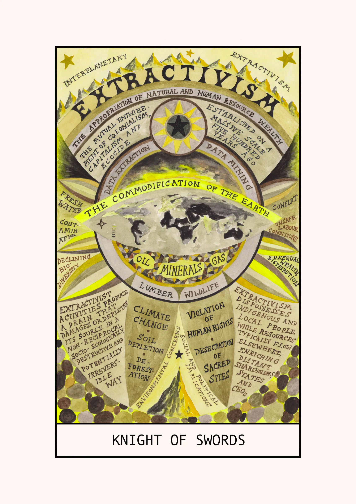

Internet network -> disposing -> geological process 

## AI and meaning 

meaning = to mean/to intend/to have in mind = sens / orientation/ faculté sensorielle / intuition / signification 

All consciousness is consciousness of something 
consciousness -> intentionality -> object 

symbol -> thought 
referent -> thought 

symbolisation of language - standardization of reasoning - mechanization - electrification - programmability - stochastization. 

### Symbolization : 

"... if a man is accused of witchcraft, he must undergo the cold water test; if his innocence is proven, his accuser must pay three shekels... " code of king ur-nammu 

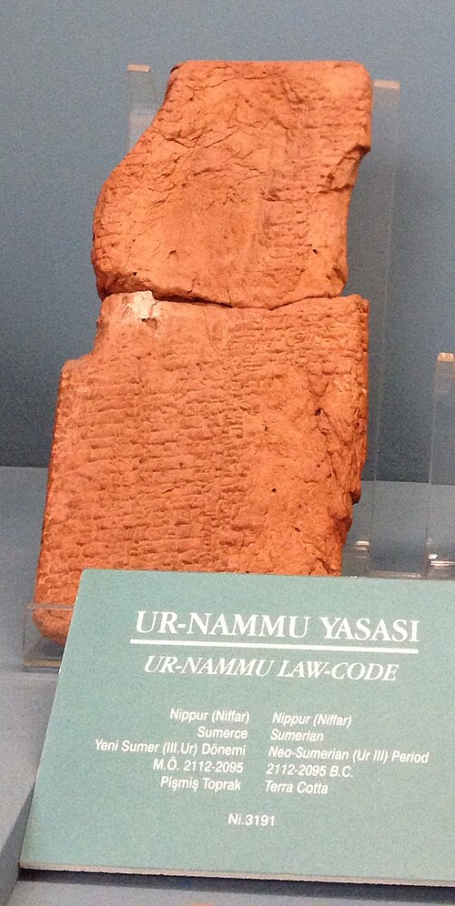

### standardization : 

India - reflective discipline distinct from VEdic ritual and dharma  
early doctrine of causes and reasons anticipating arhument analysis 
rules of debate fallacies and methods of knowledge 

Greece - protagoras formalizes language in argument and law courts. categorizes utterances of the corret speech 

Formulize methods of divination : 
- scapulomancie, chine, dynastie Shang : divination par les os
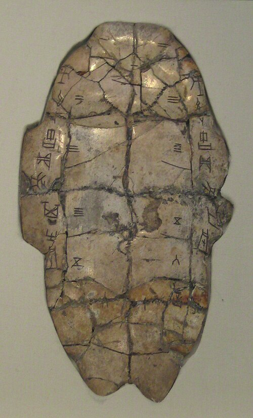

- Hexogrammes du yi jing dynastie zhou 
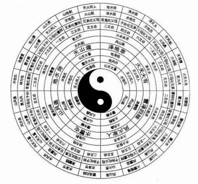
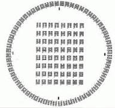

- tarot de jean nobiat, paris, 1650 , 78 cartes
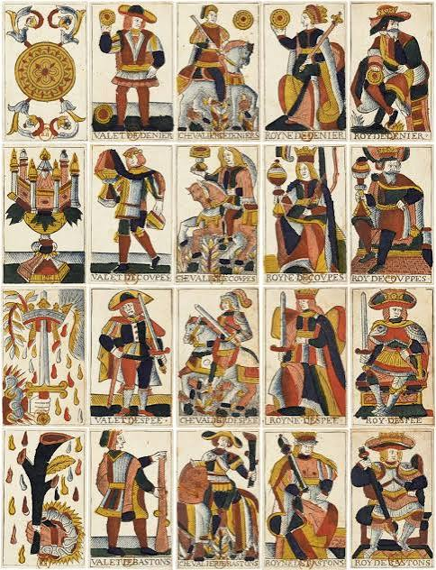

- ars notoria, sive flores durei- manuscrit apollonius de tyana 1225 
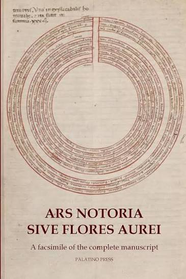
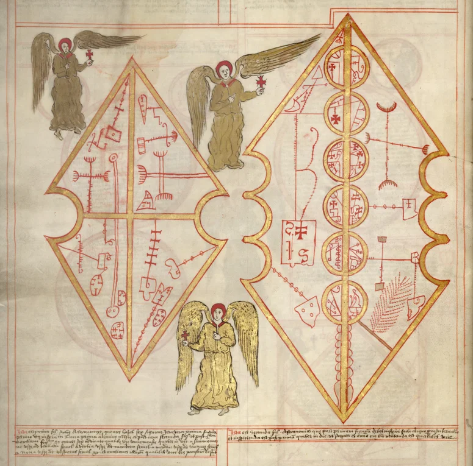
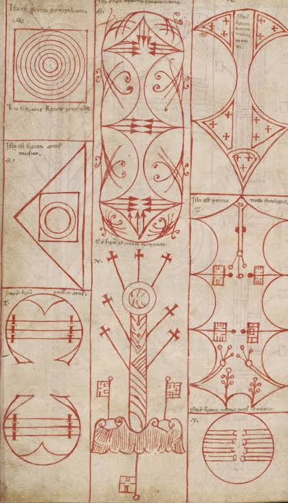

### mechanization :  

- a computer visualization of the antikythera mechanism ( hublot from seiradakis and edmunds 2018 ) our current knowledge if the antikythera mechanism - nature astronomy 
  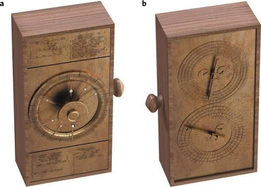
  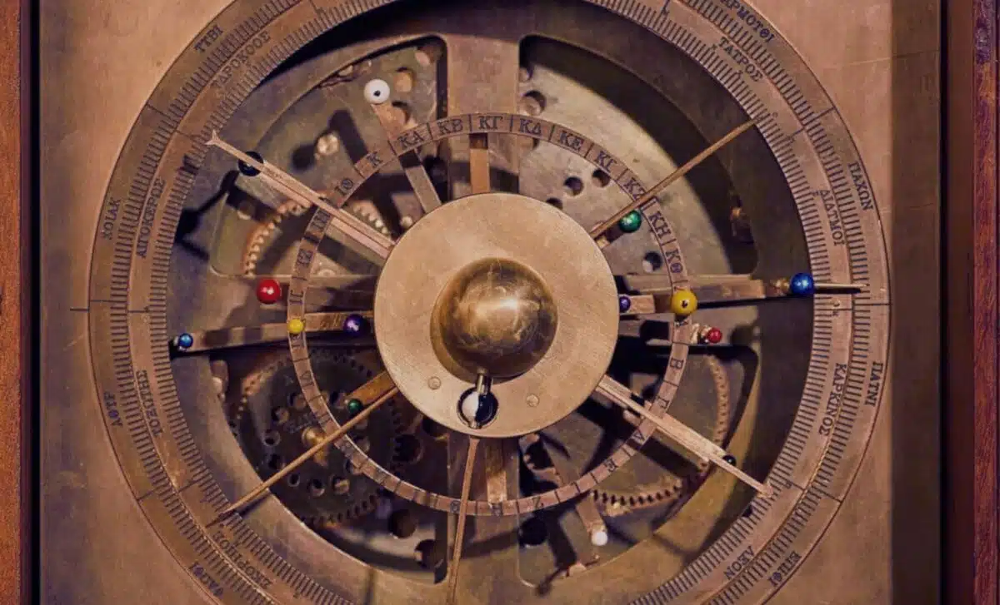
  
- Su song: treatise on the clock tower : predict observation position o fplanets - xinyl xiangfayao - yixiang method 
  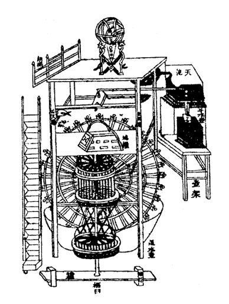

### electrification : 

- hollerith punch card 1887 :
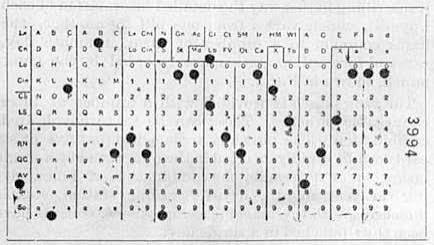
- fleming valve 1904 : first electrifying diode
  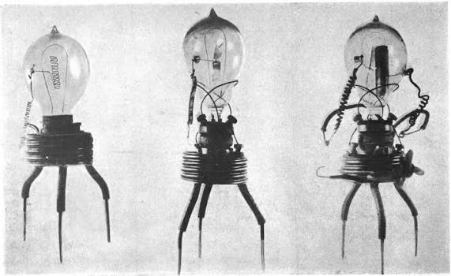
  
### programmability : 

- ENAC progmmers at Moore college 1947 first six women who prmed the worlds first modern computer hurst and company 
- EDVAC encompaddinf memeory that stored both pgm instructions and delivered 1951 
- stochatische texten -theo lutz 1959 
- zuse z22 konrad zuse technik museum berlin 

### stochastization : 

- frank rosenblatt mark 1 perceptron operators Manual NY corneli aeronautical laboratory 1960 
Organization of the mark perceptron 

## Roles of machine learning in the ecoysytem of meaning

- Lem, Stanislaw, 1964, summa technologiae. Krakow : Wydawnictwo literackie
  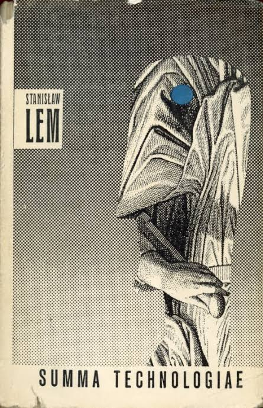

- LHC : Large hadron collider CERN : the world’s largest and highest-energy particle accelerato
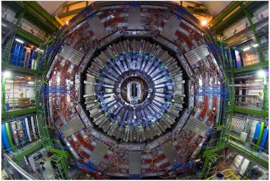

## Literatures 

- Encomials, sonnets from pentametron - Ranjit bhatnagar 2018 

- Jolicoeur martineau - alexia  [Less is More: Recursive Reasoning with Tiny Networks](https://arxiv.org/html/2510.04871v1)

- 
Coocurrence matrix -> PPMI matrix (postivie pointwise mutual information) ->  semantic space by SVD -> word2Vec 
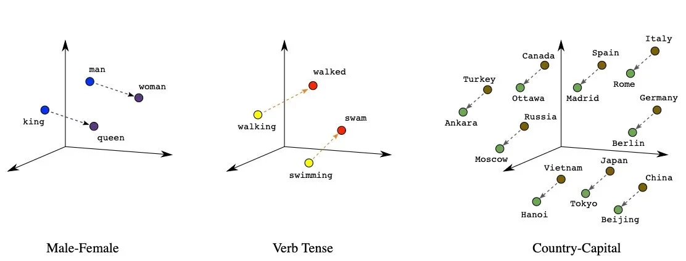 
[To read: Word Embeddings Explained: From Word2Vec to BERT and Beyond](https://www.jeannelizabeth.com/blog/word-embeddings-word2vec-to-bert)

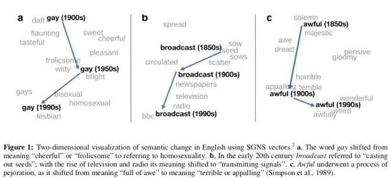
[Diachronic Word Embeddings Reveal Statistical Laws of Semantic Change](https://aryamccarthy.github.io/hamilton2016diachronic/)

- linguistics of enunciation : you cannot delefate to anyone the formulation of yourself, you can't outsource existence. 

## 

- conscience totalisante : domande de l'ia des LLM / conscience itinérante : domaine humain 
  2 manières fondamentales de concevoir le rapport de l'esprit humain au réel, au savoir et au temps en philosophie, en phénoménologie et en sciences humaines.

- Geoff Lewis : “This isn’t a redemption arc,” Lewis says in the video. “It’s a transmission, for the record. Over the past eight years, I’ve walked through something I didn’t create, but became the primary target of: a non-governmental system, not visible, but operational. Not official, but structurally real. It doesn’t regulate, it doesn’t attack, it doesn’t ban. It just inverts signal until the person carrying it looks unstable.”
  [article](https://futurism.com/openai-investor-chatgpt-mental-health)

- Habsburg AI : a term for the degradation of generative artificial intelligence that happens when a model is trained recursively on synthetic data produced by other AI models rather than fresh human data 

ai models trained predominantly on synthetic data — data generated by other AI models — risk experiencing **model collapse**, a phenomenon where outputs progressively become less diverse, less accurate, and lower in overall quality.

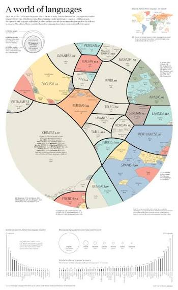