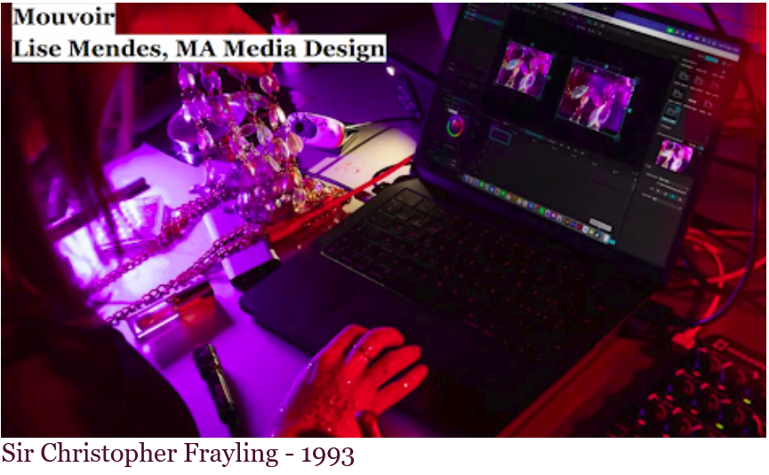
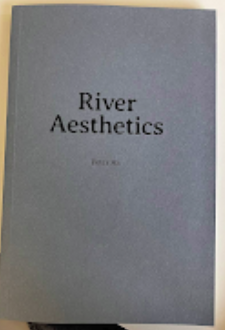
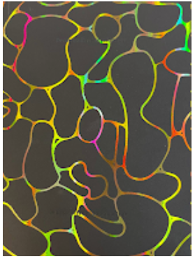

# Introduction of the course

* Sir Christopher Frayling - 1993 

## 3 categories of design research: 

-  Research **for** design : Why this design decisions

- Research **into/about** design : Analyze a phenomenon, a culture

- Research **through** design :   Rigorous, practice-based research that advances the design discipline by producing original knowledge through designing, it combines the practical virtues of research for design with the theoretical virtues of research into design.

Design research is a **systematic inquiry** that **mobilises, examines, or produces** artefacts and design processes to generate **knowledge** about design, for design, and through design.

## Questions to reflect on : 

- **Purpose** : What is it intended to do ? 

- **Value** : For whom is it useful or important ? Whose values does it represent ? 

- **Meaning**: What does it communicate, symbolize or make people feel ? 

## Watermark : 
recognizable image, pattern, text embedded into paper or digital media to identify ownership, prove authenticity, or prevent counterfeiting  

## Key questions : 

- **People** who

- **Context** where 

- **Opportunities** why 

- **Interaction** how  

 
## Reference: masters' thesis

River Aesthetics - Peter Ha  

A lesson from the sea star - Ayoub Azzouzi

 

 

 

 

 

 

 