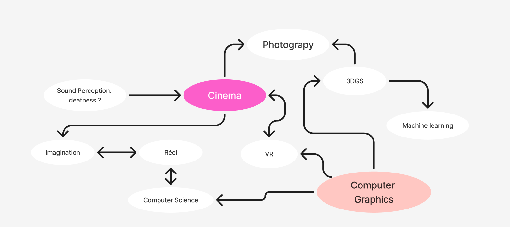

### 4 key references central to your interest 
- [MATIS work](https://www.micronaut.ch/copenhagen/) 
Using technologies, computer science in service to art. 
- [GCM](https://www.epfl.ch/labs/gcm/)
Geometric Computing Laboratory - Mark Pauly : 
Research in computer graphics, 3D modeling, rendering and image generation. Exploring how computational methods can be used to create and manipulate digital visual environments.
- [The clouds are two thousand meters up](https://www.youtube.com/watch?v=j7nkwkqc_Io&time_continue=6&source_ve_path=MjM4NTE&embeds_referring_euri=https%3A%2F%2Fwww.google.com%2F)
Creating immersive cinematic worlds through storytelling.
- [Res Natura](https://2026.giff.ch/en/film/res-natura/)

### map subject / question : 
Exploring new forms of cinematic experiences through digital technologies.
## Mind map : 

## A community : 
Cinephile : making reference to actual modern cinema ? allowing them to immerse in their favorite worlds ? 
Deaf and blind communities: exploring how can cinematic experiences be adapted to different ways of perceiving images and sound ? 

## Questions 

I want to explore how new technologies can transform the creation of cinematic images.
How can VR expand the language and experience of cinema ? How can we create a universe which initially exists in the form of drawn into habitable images ? 
Related to : CGI, photography, 3DGS, ML, VFX, computational imaging.
How can we design immersive experiences that accommodate different sensory abilities and ways of perceiving the world ? Like making more intense some sense for the ones who don't have ? 

### Think about an angle of approach 
Experimental approach and a representative one like to understand how do we do now and how can we go further to combine cinematic language, photography and computational image rendering. 
Investigate new forms of immersive storytelling and spectatorship.

- [Cinema without frames](https://journals.sagepub.com/doi/10.1177/13548565251383405) : 
A study that examines how virtual reality (VR) cinema transforms spectatorship, embodiment, and narrative engagement through a specific ref