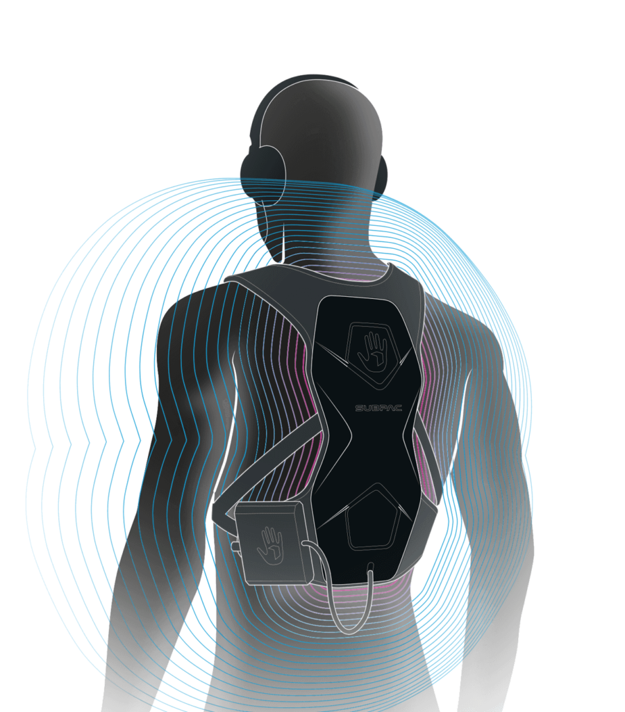
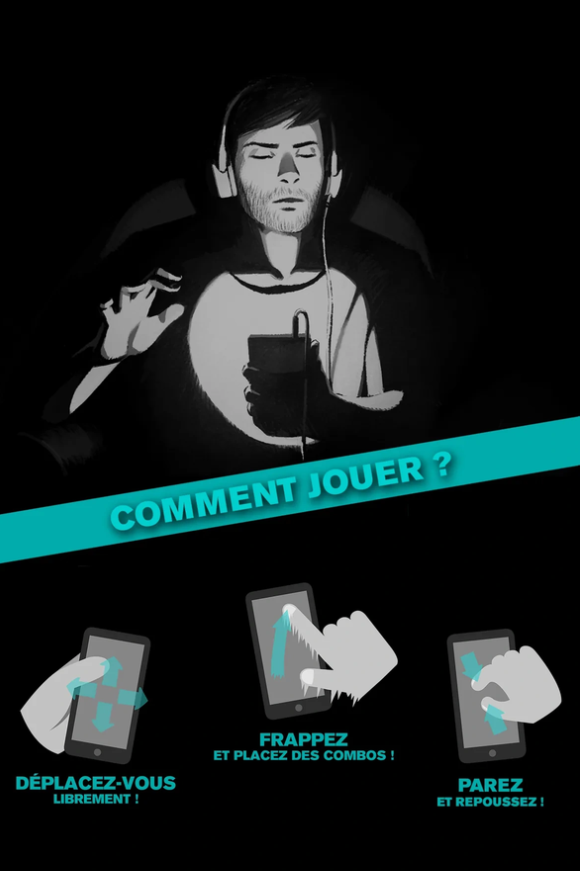

## 3 key references : 

- [SoundX](https://www.soundx.fr/en) : Vibration pack 
https://www.sinfonietta.ch/gilets-vibrants/ 

In lausanne they propose it 

  
- [Article about haptic cinema](https://journals.openedition.org/entrelacs/485?lang=en)
  
Touch as a cinematic language and memory of the senses

- [Blind Legend](https://tontonstudio.com/references/serious_games/a_blind_legend/)

## First question draft : 
How can a cinematic scene generate real-time haptic mapping to enrich the emotional experience for all auiences, including deaf and blind viewers ? 

--- 

### Vocabulary : 

Haptic means relating to or based on the sense of touch. It often refers to using physical sensations—like vibrations, pulses, or resistance. 

### All ref used during research : 

- https://casco.art/activity/optic-to-haptic-cinema-oh-cinema/
- binaural audio technology https://tontonstudio.com/references/serious_games/a_blind_legend/
- About haptic visuality in film — Hannaleena Hauru : https://www.hannaleenahauru.com/essays/haptic
- Brouillard créatif : stratégie et pratique du cinéma haptique – Les médiathécaires néolouvanistes
    https://mediathecaire.wordpress.com/2013/01/23/brouillard-creatif-strategie-et-pratique-du-cinema-haptique/
- Ce que raconte le toucher : vers un cinéma d'animation haptique | ENSAD
    https://www.ensad.fr/fr/ce-que-raconte-le-toucher-vers-un-cinema-danimation-haptique
- Cinéma pour les déficients visuels...avec de l'audio sous-titrage !
    Vidéo YouTube (Chaîne : Handicap Fr)
- D-BOX | Faire vibrer le monde grâce à la technologie haptique
    https://www.d-box.com/fr/
- Dispositif haptique — Wikipédia
    https://fr.wikipedia.org/wiki/Dispositif_haptique
- Filmscalpel | Haptic Malick
    https://www.filmscalpel.com/haptic-malick/
- Geometric Computing Laboratory ‐ EPFL
    https://www.epfl.ch/labs/gcm/
- Gilets vibrants | Le Sinfonietta de Lausanne
    https://www.sinfonietta.ch/gilets-vibrants/
- La caméra haptique de Philippe Grandrieux : « le surgissement d'un autre monde »
    https://journals.openedition.org/entrelacs/485
- Musique vibrante - TOBS
    https://www.tobs.ch/fr/now/article/musique-vibrante
- The Skin of the Film: Intercultural Cinema, Embodiment, and the Senses
    https://www.dukeupress.edu/the-skin-of-the-film
- Un orchestre invente des concerts accessibles avec gilets vibrants et avatar en langue des signes
    Vidéo YouTube (Chaîne : France TV - ICI Nouvelle-Aquitaine)
- Une séance de cinéma pour personnes sourdes et malentendantes
    Vidéo YouTube (Chaîne : France TV - ICI Grand Est)
- What Is Haptic Feedback Theater Seating and How Does It Enhance Your Home Cinema? – Theater Seat Shop
    https://theaterseatshop.com/blogs/knowledge/what-is-haptic-feedback-theater-seating-and-how-does-it-enhance-your-home-cinema